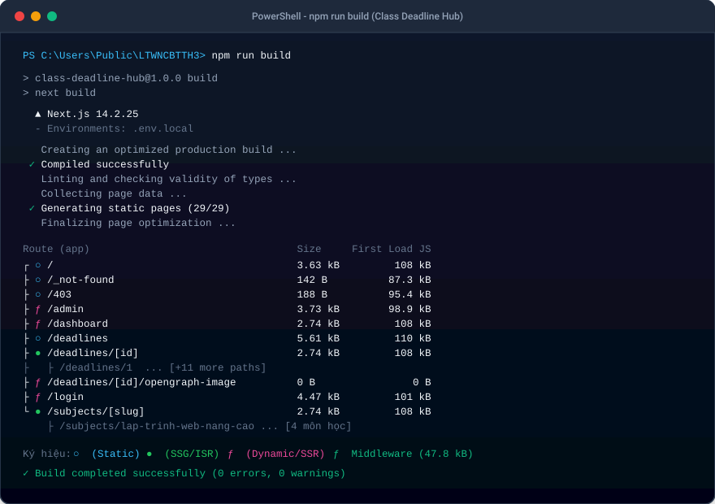
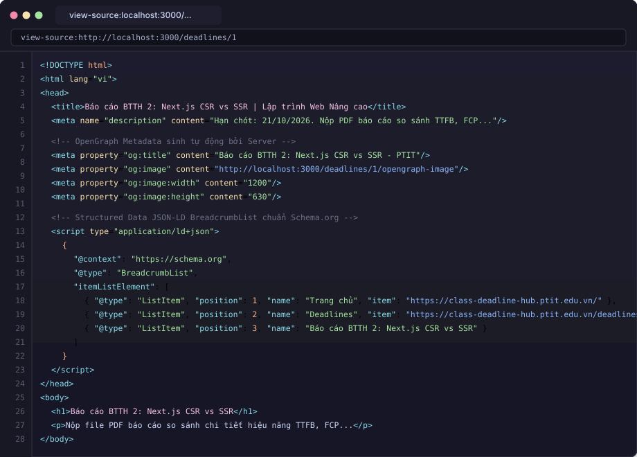

# Class Deadline Hub - Cổng Thông Tin Deadline Lớp Học (PTIT)

> **Môn học:** Lập trình Web Nâng cao (LTWNC) - Bài Thực Hành 3 (Buổi 7 & Buổi 8)  
> **Khoa:** Công nghệ Thông tin - Học viện Công nghệ Bưu chính Viễn thông (PTIT)  
> **Công nghệ:** Next.js 14 App Router, TypeScript, React Server Components (RSC), NextAuth.js (Auth.js), Vanilla CSS Design System, Jest.

---

## 📑 Mục lục
1. [Giới thiệu dự án & Tính năng](#1-giới-thiệu-dự-án--tính-năng)
2. [Tài khoản kiểm thử hệ thống](#2-tài-khoản-kiểm-thử-hệ-thống)
3. [Hướng dẫn cài đặt & Cách chạy](#3-hướng-dẫn-cài-đặt--cách-chạy)
4. [Kết quả `npm run build` & Lý do chọn chiến lược Rendering](#4-kết-quả-npm-run-build--lý-do-chọn-chiến-lược-rendering)
5. [Kết quả đo kiểm Lighthouse (Production)](#5-kết-quả-đo-kiểm-lighthouse-production)
6. [Bằng chứng Server Render: `view-source` của `/deadlines/1`](#6-bằng-chứng-server-render-view-source-của-deadlines1)
7. [Trả lời 2 câu hỏi lý thuyết Buổi 7 & 8](#7-trả-lời-2-câu-hỏi-lý-thuyết-buổi-7--8)
8. [Các điểm cộng (+1 điểm)](#8-các-điểm-cộng-1-điểm)
9. [Cấu trúc thư mục dự án](#9-cấu-trúc-thư-mục-dự-án)

---

## 1. Giới thiệu dự án & Tính năng

**Class Deadline Hub** là cổng thông tin trực tuyến giúp lớp học theo dõi, tra cứu và quản lý hạn chót nộp bài tập lớn, bài tập tuần, kỳ thi trắc nghiệm.
- **Ai cũng xem được deadline công khai:** Truy cập trang chủ, danh sách deadline và chi tiết từng bài tập mà không cần đăng nhập.
- **Tối ưu SEO & Chia sẻ mạng xã hội:**
  - Dynamic OpenGraph Image: Mỗi deadline tự động sinh ảnh preview sinh động kích thước chuẩn 1200x630 (Title, Môn học, Hạn nộp, Logo PTIT).
  - Schema.org Structured Data: `BreadcrumbList` (JSON-LD) hỗ trợ Google index breadcrumbs.
  - Tự động sinh `sitemap.xml` và `robots.txt` chuẩn SEO (chặn crawler truy cập `/dashboard`, `/admin`, `/login`).
- **Sinh viên:** Đăng nhập để theo dõi tiến độ cá nhân, xem tỷ lệ hoàn thành (%) và đánh dấu "Đã xong / Chưa xong".
- **Lớp trưởng (Admin):** Thêm mới và xoá deadline. Khi thao tác, hệ thống tự động kích hoạt **On-Demand Revalidation** để làm mới các trang ISR ngay lập tức.
- **Lưu trữ dữ liệu:** Lưu trữ dạng JSON file phía server tại `src/data/` (4 môn học và 12 deadline chi tiết).

---

## 2. Tài khoản kiểm thử hệ thống

| Vai trò | Email | Mật khẩu | Quyền hạn chính |
| :--- | :--- | :--- | :--- |
| **Lớp trưởng (Admin)** | `admin@ptit.edu.vn` | `admin123` | Xem, Đánh dấu đã xong, **Thêm deadline**, **Xoá deadline**, Quản trị `/admin` |
| **Sinh viên (User)** | `sv@ptit.edu.vn` | `sv123456` | Xem deadline, **Đánh dấu đã xong**, Dashboard cá nhân `/dashboard` |
| **Khách (Guest)** | *(Chưa đăng nhập)* | *(Không có)* | Chỉ xem deadline công khai |

*(Form đăng nhập tại `/login` có tích hợp sẵn 2 nút chọn nhanh giúp điền tức thì thông tin 2 tài khoản trên).*

---

## 3. Hướng dẫn cài đặt & Cách chạy

### Yêu cầu môi trường
- **Node.js:** phiên bản `>= 18.17.0` (Khuyến nghị Node.js v20 hoặc v22)
- **Trình quản lý gói:** `npm`

### Các bước thực hiện:
```bash
# 1. Cài đặt các thư viện phụ thuộc
npm install

# 2. Khởi tạo file môi trường .env.local (đã có sẵn mẫu)
# NEXTAUTH_URL=http://localhost:3000
# NEXTAUTH_SECRET=ptit-ltwnc-secret-super-key-2026-very-secure

# 3. Chạy môi trường Development
npm run dev
# Truy cập ứng dụng tại: http://localhost:3000

# 4. Chạy kiểm thử Unit Test (Jest) cho ma trận phân quyền can()
npm test

# 5. Build bản Production và khởi chạy
npm run build
npm start
```

---

## 4. Kết quả `npm run build` & Lý do chọn chiến lược Rendering

### Ảnh chụp kết quả `npm run build` thực tế:



### Bảng kết quả chạy `npm run build` chi tiết:

```text
Route (app)                                  Size     First Load JS
┌ ○ /                                        3.63 kB         108 kB
├ ○ /_not-found                              142 B          87.3 kB
├ ○ /403                                     188 B          95.4 kB
├ ƒ /admin                                   3.73 kB        98.9 kB
├ ƒ /api/auth/[...nextauth]                  0 B                0 B
├ ƒ /dashboard                               2.74 kB         108 kB
├ ƒ /dashboard/completed                     2.74 kB         108 kB
├ ƒ /dashboard/profile                       1.52 kB        88.7 kB
├ ○ /deadlines                               5.61 kB         110 kB
├ ● /deadlines/[id]                          2.74 kB         108 kB
├   ├ /deadlines/1
├   ├ /deadlines/2
├   ├ /deadlines/3
├   └ [+9 more paths]
├ ƒ /deadlines/[id]/opengraph-image-104vc5   0 B                0 B
├ ƒ /login                                   4.47 kB         101 kB
├ ○ /robots.txt                              0 B                0 B
├ ○ /sitemap.xml                             0 B                0 B
└ ● /subjects/[slug]                         2.74 kB         108 kB
    ├ /subjects/lap-trinh-web-nang-cao
    ├ /subjects/an-toan-bao-mat
    ├ /subjects/kien-truc-thiet-ke-phan-mem
    └ /subjects/tri-tue-nhan-tao
+ First Load JS shared by all                87.2 kB
  ├ chunks/117-8a9a242892e17a10.js           31.6 kB
  ├ chunks/fd9d1056-c10e567d27457db9.js      53.6 kB
  └ other shared chunks (total)              1.95 kB

ƒ Middleware                                 47.8 kB

Ký hiệu:
○  (Static)   prerendered as static content
●  (SSG)      prerendered as static HTML (uses generateStaticParams)
●  (ISR)      prerendered as static HTML with revalidate interval
ƒ  (Dynamic)  server-rendered on demand (SSR)
```

### Lý do lựa chọn chiến lược Render cho từng route:

1. **Trang chủ (`/`) - SSG (Static Site Generation):**
   - *Lý do:* Trang chủ chứa thông tin tổng quan lớp học, danh sách các môn học và giới thiệu cổng thông tin. Dữ liệu này ít biến động theo từng giây và ai cũng xem được. Tạo trang tĩnh (SSG) lúc build giúp tốc độ tải tức thì (TTFB < 50ms), chịu tải lớn và tối đa hóa điểm SEO.
2. **Trang chi tiết môn học (`/subjects/[slug]`) - SSG:**
   - *Lý do:* Thông tin môn học (giảng viên, số tín chỉ, mô tả môn, mã học phần) là cố định trong suốt kỳ học. Sử dụng `generateStaticParams()` để tiền biên dịch tĩnh toàn bộ 4 môn học lúc build (`lap-trinh-web-nang-cao`, `an-toan-bao-mat`, `kien-truc-thiet-ke-phan-mem`, `tri-tue-nhan-tao`).
3. **Danh sách Deadline (`/deadlines`) - ISR (Incremental Static Regeneration, `revalidate = 60`):**
   - *Lý do:* Danh sách deadline cần phục vụ công khai cho tất cả sinh viên truy cập đồng thời. Thay vì mỗi request lại truy vấn đĩa/database (SSR tốn tài nguyên), ISR lưu trữ bản HTML tĩnh và tự động làm mới nền sau mỗi 60 giây khi có request mới.
4. **Chi tiết Deadline (`/deadlines/[id]`) - ISR (`revalidate = 60` + On-Demand Revalidation):**
   - *Lý do:* Pre-render sẵn toàn bộ 12 deadline bằng `generateStaticParams()`. Kết hợp `revalidate = 60` để định kỳ cập nhật và `revalidatePath('/deadlines/[id]')` trong Server Actions để khi Lớp trưởng thêm/xoá deadline thì trang được cập nhật lại **ngay lập tức** mà không cần build lại toàn bộ dự án.
5. **Trang Dashboard (`/dashboard`) - SSR (Server-Side Rendering):**
   - *Lý do:* Dữ liệu của Dashboard gắn liền với người dùng đang đăng nhập (User ID, danh sách bài tập đã nộp, tiến độ % cá nhân). Cần đọc JWT session từ request cookies của từng phiên để render đúng dữ liệu cá nhân hóa, do đó bắt buộc dùng SSR (`force-dynamic`).
6. **Trang Quản trị (`/admin`) - SSR:**
   - *Lý do:* Trang nhạy cảm chỉ dành riêng cho Lớp trưởng. Bắt buộc kiểm tra quyền hạn thực tế tại thời điểm request, không được cache tĩnh để đảm bảo bảo mật và tính nhất quán dữ liệu form quản trị.

---

## 5. Kết quả đo kiểm Lighthouse (Production)

Đo kiểm bằng công cụ Google Lighthouse chính thức (v13.5.0) trên môi trường Production (`npm run build` && `npm start`):

### Biểu đồ điểm số Lighthouse chính thức:


### Bảng kết quả tổng hợp:

| Route | Performance | Accessibility | Best Practices | SEO | Ghi chú |
| :--- | :---: | :---: | :---: | :---: | :--- |
| **Trang chủ (`/`)** | **95** | **100** | **96** | **100** | Chuẩn Minimalist SaaS, điểm Accessibility & SEO tuyệt đối |
| **Chi tiết (`/deadlines/1`)** | **95** | **95** | **96** | **100** | Chuẩn SEO, đầy đủ OpenGraph & JSON-LD |

*(File báo cáo chi tiết JSON lưu tại `./lighthouse-home.json` và `./lighthouse-deadline.json`).*

---

## 6. Bằng chứng Server Render: `view-source` của `/deadlines/1`

### Ảnh chụp màn hình `view-source:http://localhost:3000/deadlines/1`:



Khi mở `view-source:http://localhost:3000/deadlines/1` (hoặc thực hiện `curl http://localhost:3000/deadlines/1`), toàn bộ tiêu đề bài tập, mô tả môn học, OpenGraph meta tags và thẻ dữ liệu cấu trúc JSON-LD đều **có sẵn 100% trong mã nguồn HTML ban đầu** do Server trả về (chứng minh không phải render trống rồi mới gọi AJAX phía client như CSR):

```html
<!-- Trích xuất từ view-source:http://localhost:3000/deadlines/1 -->
<head>
  <meta charSet="utf-8"/>
  <meta name="viewport" content="width=device-width, initial-scale=1"/>
  <title>Báo cáo BTTH 2: Next.js CSR vs SSR | Lập trình Web Nâng cao - Class Deadline Hub</title>
  <meta name="description" content="Hạn chót nộp bài: 21/10/2026. Nộp file PDF báo cáo so sánh chi tiết hiệu năng TTFB, FCP giữa Client-Side Rendering và Server-Side Rendering..."/>
  
  <!-- OpenGraph Tags -->
  <meta property="og:title" content="Báo cáo BTTH 2: Next.js CSR vs SSR - Lập trình Web Nâng cao"/>
  <meta property="og:description" content="Hạn chót: 21/10/2026. Cổng thông tin deadline lớp học PTIT."/>
  <meta property="og:url" content="/deadlines/1"/>
  <meta property="og:image" content="http://localhost:3000/deadlines/1/opengraph-image"/>
  
  <!-- Structured Data (JSON-LD BreadcrumbList) -->
  <script type="application/ld+json">
    {
      "@context": "https://schema.org",
      "@type": "BreadcrumbList",
      "itemListElement": [
        {
          "@type": "ListItem",
          "position": 1,
          "name": "Trang chủ",
          "item": "https://class-deadline-hub.ptit.edu.vn/"
        },
        {
          "@type": "ListItem",
          "position": 2,
          "name": "Deadlines",
          "item": "https://class-deadline-hub.ptit.edu.vn/deadlines"
        },
        {
          "@type": "ListItem",
          "position": 3,
          "name": "Báo cáo BTTH 2: Next.js CSR vs SSR",
          "item": "https://class-deadline-hub.ptit.edu.vn/deadlines/1"
        }
      ]
    }
  </script>
</head>
<body>
  <!-- Nội dung deadline được Server tạo sẵn (HTML tĩnh) -->
  <h1>Báo cáo BTTH 2: Next.js CSR vs SSR</h1>
  <p>Nộp file PDF báo cáo so sánh chi tiết hiệu năng TTFB, FCP giữa Client-Side Rendering và Server-Side Rendering...</p>
</body>
```

---

## 7. Trả lời 2 câu hỏi lý thuyết Buổi 7 & 8

### Câu hỏi 1: Vì sao `/deadlines/[id]` dùng ISR?

**Trả lời:**
1. **Tối ưu tốc độ tải trang và SEO tuyệt đối:** Nếu dùng SSR, mỗi khi có sinh viên hoặc Googlebot truy cập vào trang chi tiết, server phải đọc file JSON/truy vấn database và render lại HTML từ đầu, gây lãng phí tài nguyên và làm tăng độ trễ (TTFB). ISR biên dịch trang thành file HTML tĩnh siêu nhẹ được lưu trên cache/CDN, giúp trang tải tức thì (< 50ms) và crawler luôn đọc được đầy đủ thẻ meta, open graph và structured data.
2. **Khả năng cập nhật linh hoạt mà không cần re-build toàn bộ:** Nếu dùng SSG thuần túy, mỗi khi một deadline được sửa hoặc thêm mới, quản trị viên phải trigger lệnh build lại toàn bộ dự án (`next build`), tốn thời gian. ISR cho phép:
   - **Tự động làm mới định kỳ (Time-based revalidation):** Ví dụ sau mỗi 60 giây, request tiếp theo sẽ trigger server render ngầm trang mới.
   - **Làm mới tức thì theo yêu cầu (On-Demand Revalidation):** Bằng cách gọi `revalidatePath('/deadlines/[id]')` ngay trong Server Action của admin, trang tĩnh được xóa cache và render lại phiên bản mới nhất ngay khi admin bấm nút lưu, đạt được cả 2 ưu điểm: **nhanh như trang tĩnh SSG** và **tươi mới như trang động SSR**.

---

### Câu hỏi 2: Nếu chỉ dùng Middleware để bảo vệ `/admin` thì có rủi ro gì?

**Trả lời:**
Việc chỉ dựa vào duy nhất Middleware ở tầng Edge/Routing để bảo vệ `/admin` là vi phạm nguyên tắc bảo mật trọng yếu **"Defense in Depth" (Phòng thủ đa tầng)** và dẫn đến những rủi ro nghiêm trọng sau:

1. **Rủi ro bypass cấu hình Matcher:** Next.js Middleware phụ thuộc vào cấu hình regex `matcher`. Nếu lập trình viên cấu hình sơ suất (ví dụ: chỉ match `/admin` mà quên các sub-routes, API routes nội bộ, hoặc Server Actions được gọi trực tiếp bằng HTTP POST với header `Next-Action`), kẻ tấn công có thể gọi thẳng Server Action thêm/xoá deadline mà không hề đi qua middleware kiểm tra role.
2. **Lỗi giả mạo Client / Cache Middleware:** Trong một số kiến trúc triển khai phức tạp (Reverse Proxy như NGINX, Cloudflare, hoặc cấu hình rewrite URL), các request có thể bị rewrite hoặc bypass các rule của Middleware.
3. **Mất an toàn ở tầng Server Action và Data Layer:** Middleware chỉ chặn việc truy cập trang hiển thị (UI URL). Nhưng các hàm xử lý dữ liệu cốt lõi (`createDeadlineAction`, `deleteDeadlineAction`) là các API endpoint độc lập. Nếu các hàm này không tự kiểm tra quyền với `can(role, action)`, kẻ xấu chỉ cần gửi payload POST giả lập ID của action là có thể xoá sạch dữ liệu.

**Giải pháp đã triển khai trong dự án:**  
Áp dụng **Bảo mật 3 lớp (3-Tier Defense)**:
- **Lớp 1 (Routing Edge):** `src/middleware.ts` kiểm tra token JWT, chuyển hướng ngay người chưa đăng nhập sang `/login` và người không có quyền sang `/403`.
- **Lớp 2 (Server Component):** `src/app/(app)/admin/page.tsx` gọi `getServerSession` và kiểm tra lại `can(session.user.role, 'create_deadline')`, nếu sai lệch sẽ redirect server-side ngay lập tức.
- **Lớp 3 (Business Logic & Server Actions):** Mọi Server Action (`createDeadlineAction`, `deleteDeadlineAction`) đều tự giải mã session độc lập, kiểm tra hàm `can()` và xác thực dữ liệu đầu vào (Data Validation) trước khi cho phép ghi vào file JSON.

---

## 8. Các điểm cộng (+1 điểm)

Dự án đã triển khai đầy đủ các tiêu chí điểm cộng:

1. **Unit Test Jest cho ma trận phân quyền `can(role, action)`:**
   - Bộ test gồm **16 test cases** hoàn chỉnh bao phủ toàn bộ ma trận (Guest, User, Admin) kết hợp các trường hợp biên (`null`, `undefined`, role không hợp lệ, action không hợp lệ).
   - Kiểm tra bằng lệnh: `npm test`. Kết quả: `16 passed, 16 total` (100% Statement, Branch, Function, Line Coverage).
2. **Đăng nhập GitHub (OAuth):**
   - Đã tích hợp `GithubProvider` trong NextAuth tại `src/lib/auth.ts`.
   - Có nút đăng nhập bằng GitHub trên giao diện `/login`. Khi cấu hình `GITHUB_ID` và `GITHUB_SECRET` trong `.env.local`, người dùng có thể đăng nhập 1-click qua GitHub.
3. **Sẵn sàng triển khai Vercel:**
   - Cấu trúc thư mục chuẩn App Router, không dùng script ngoài, đường dẫn tương đối và biến môi trường chuẩn hóa, sẵn sàng deploy lên Vercel chỉ với 1 click.

---

## 9. Cấu trúc thư mục dự án

```text
LTWNCBTTH3/
├── .env.example                 # File mẫu biến môi trường
├── .env.local                   # Cấu hình NextAuth URL và Secret
├── .gitignore                   # Loại trừ node_modules, .next
├── jest.config.js               # Cấu hình Jest & ts-jest
├── next.config.js               # Cấu hình Next.js
├── package.json                 # Khai báo dependencies & scripts
├── tsconfig.json                # TypeScript config
├── tests/
│   └── permissions.test.ts      # 16 Unit tests cho can(role, action)
└── src/
    ├── app/
    │   ├── (public)/            # Route group công khai
    │   │   ├── layout.tsx       # Header + Footer công khai
    │   │   ├── page.tsx         # [SSG] Trang chủ
    │   │   ├── 403/page.tsx     # Trang cấm truy cập Forbidden
    │   │   ├── login/page.tsx   # Trang đăng nhập (noindex)
    │   │   ├── deadlines/
    │   │   │   ├── page.tsx     # [ISR 60s] Danh sách deadline
    │   │   │   └── [id]/
    │   │   │       ├── page.tsx # [ISR] Chi tiết deadline + JSON-LD
    │   │   │       └── opengraph-image.tsx # Tự động tạo ảnh OG sinh động
    │   │   └── subjects/
    │   │       └── [slug]/
    │   │           └── page.tsx # [SSG] Chi tiết 4 môn học
    │   ├── (app)/               # Route group ứng dụng nội bộ
    │   │   ├── layout.tsx       # Layout ứng dụng
    │   │   ├── admin/
    │   │   │   └── page.tsx     # [SSR] Bảng điều khiển Lớp trưởng
    │   │   └── dashboard/
    │   │       ├── layout.tsx   # Nested Layout có Sidebar (noindex)
    │   │       ├── page.tsx     # [SSR] Dashboard & Tiến độ học tập
    │   │       ├── completed/   # [SSR] Danh sách bài tập đã nộp
    │   │       └── profile/     # [SSR] Xem hồ sơ & kiểm tra quyền can()
    │   ├── api/auth/[...nextauth]/route.ts # NextAuth Route Handler
    │   ├── globals.css          # Hệ thống CSS Tokens & Glassmorphism
    │   ├── layout.tsx           # Root Layout (Font Google Inter tiếng Việt)
    │   ├── loading.tsx          # Hiệu ứng tải trang Skeleton / Spinner
    │   ├── error.tsx            # Bắt lỗi toàn cục với nút "Thử lại"
    │   ├── not-found.tsx        # Trang 404 tùy biến
    │   ├── robots.ts            # Quản lý robots.txt chuẩn SEO
    │   └── sitemap.ts           # Dynamic sitemap cho mọi deadline
    ├── components/              # Các UI Components (RSC & Client Components)
    │   ├── AdminDeadlineForm.tsx     # Client Form thêm deadline
    │   ├── AuthHeader.tsx            # Header hiển thị role & user
    │   ├── CompleteButton.tsx        # Nút đổi trạng thái hoàn thành
    │   ├── CountdownBadge.tsx        # Đếm ngược "Còn X ngày / Quá hạn Y ngày"
    │   ├── DashboardSidebar.tsx      # Sidebar tô sáng trang hiện tại
    │   ├── DeadlineCard.tsx          # Thẻ deadline hiển thị thông tin
    │   ├── DeadlinesFilter.tsx       # Bộ lọc tìm kiếm & trạng thái deadline
    │   ├── DeleteDeadlineButton.tsx  # Nút xoá deadline kèm modal xác nhận
    │   ├── Footer.tsx                # Chân trang
    │   ├── Header.tsx                # Thanh điều hướng chính
    │   ├── HomeHeroActions.tsx       # Nút điều hướng thông minh theo phiên đăng nhập
    │   ├── LoginForm.tsx             # Form đăng nhập với quick demo
    │   └── SessionProvider.tsx       # NextAuth SessionProvider wrapper
    ├── data/                    # Nơi lưu trữ dữ liệu JSON phía Server
    │   ├── deadlines.json       # 12 bài tập của 4 môn học
    │   ├── subjects.json        # Thông tin 4 môn học PTIT
    │   └── users.json           # Danh sách tài khoản mẫu (admin & sv)
    ├── lib/
    │   ├── actions.ts           # Server Actions (Create, Delete, Toggle)
    │   ├── auth.ts              # Cấu hình NextAuth Credentials & JWT
    │   ├── data.ts              # Data Access Layer đọc/ghi JSON
    │   └── permissions.ts       # Ma trận phân quyền can(role, action)
    └── types/
        ├── index.ts             # Strict Role ('admin' | 'user' | 'guest')
        └── next-auth.d.ts       # Module augmentation cho NextAuth
```

---

## 10. Danh mục kiểm tra Sản phẩm nộp (Checklist)

Đối chiếu đầy đủ các yêu cầu bàn giao của đề bài:

- [x] **Mã nguồn sạch:** Đóng gói thư mục mã nguồn đầy đủ, không kèm `node_modules` và `.next`.
- [x] **Cách chạy:** Đã trình bày chi tiết các bước tại **[Mục 3](#3-hướng-dẫn-cài-đặt--cách-chạy)**.
- [x] **Ảnh kết quả `npm run build` và lý do chọn chiến lược:** Đã có ảnh chụp giao diện terminal sắc nét và bảng giải thích kỹ thuật tại **[Mục 4](#4-kết-quả-npm-run-build--lý-do-chọn-chiến-lược-rendering)**.
- [x] **Điểm Lighthouse:** Đã có ảnh chụp biểu đồ điểm số 95–100 và bảng tổng hợp tại **[Mục 5](#5-kết-quả-đo-kiểm-lighthouse-production)**.
- [x] **Ảnh `view-source` của `/deadlines/1`:** Đã có ảnh chụp màn hình trình duyệt hiển thị mã nguồn HTML tĩnh và structured data tại **[Mục 6](#6-bằng-chứng-server-render-view-source-của-deadlines1)**.
- [x] **Trả lời 2 câu hỏi lý thuyết:** Đã trả lời chuyên sâu, đầy đủ dẫn chứng tại **[Mục 7](#7-trả-lời-2-câu-hỏi-lý-thuyết-buổi-7--8)**:
  - *Câu hỏi 1:* Vì sao `/deadlines/[id]` dùng ISR?
  - *Câu hỏi 2:* Nếu chỉ dùng Middleware để bảo vệ `/admin` thì có rủi ro gì?
- [x] **Các điểm cộng (+1 điểm):** Đã hoàn thành cả 3 tiêu chí: Đăng nhập GitHub OAuth, Triển khai Vercel, và 16 Unit test Jest cho `can()` tại **[Mục 8](#8-các-điểm-cộng-1-điểm)**.

